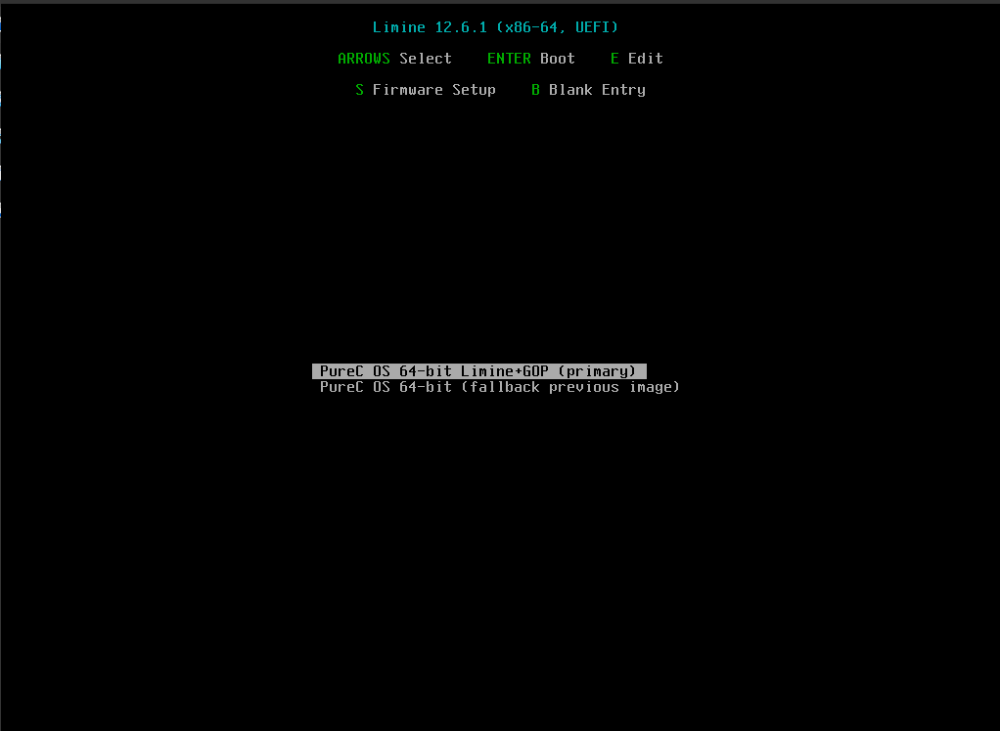
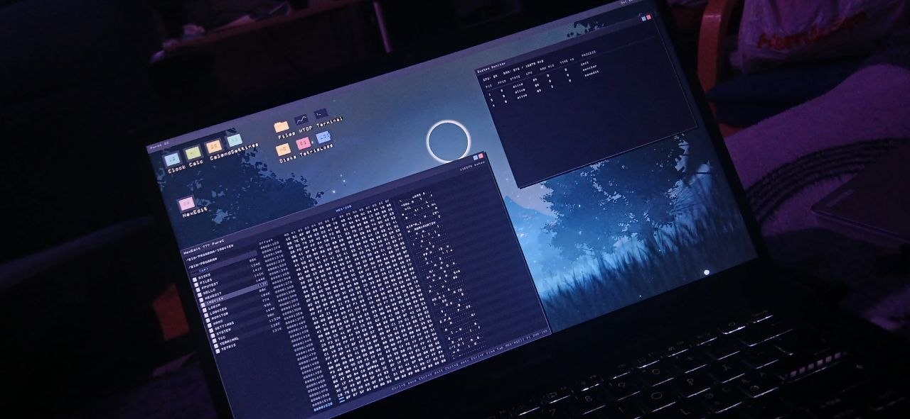
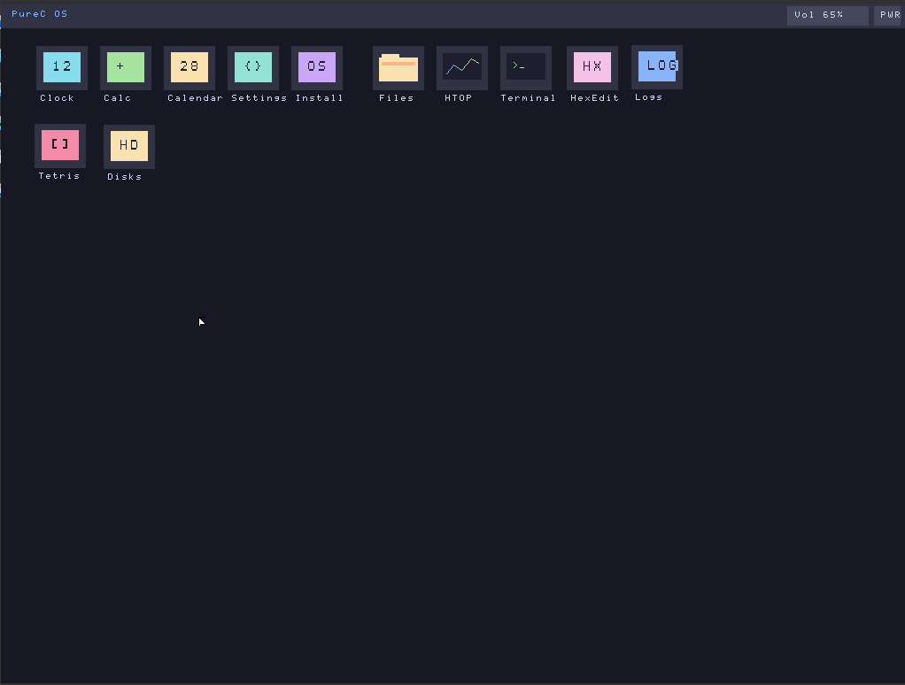
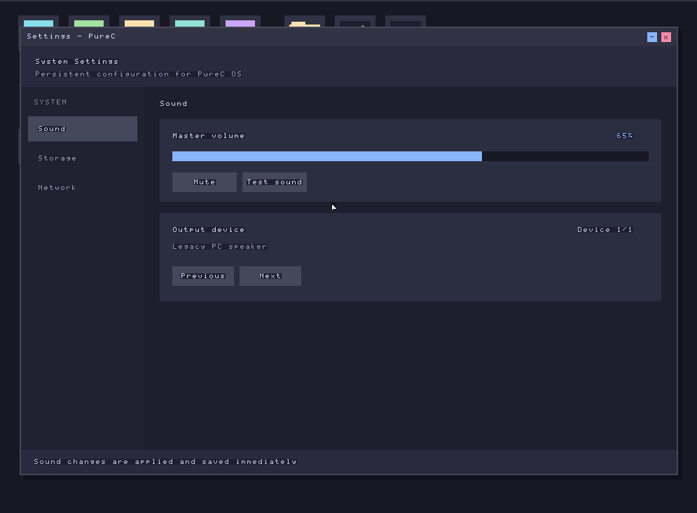
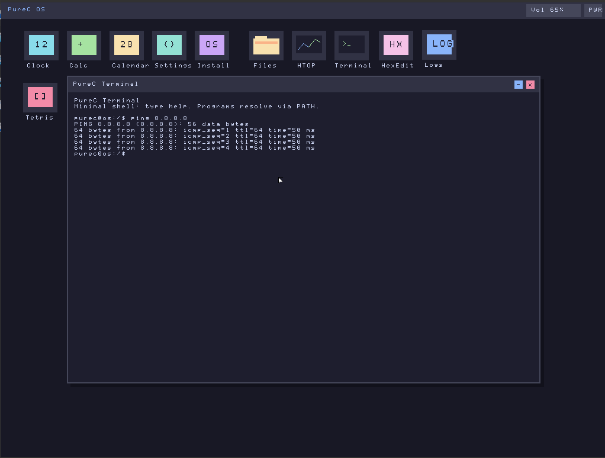
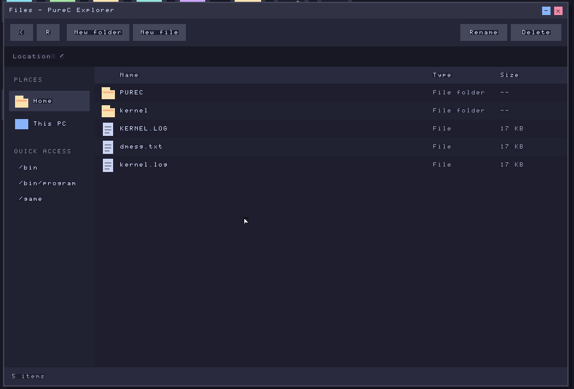
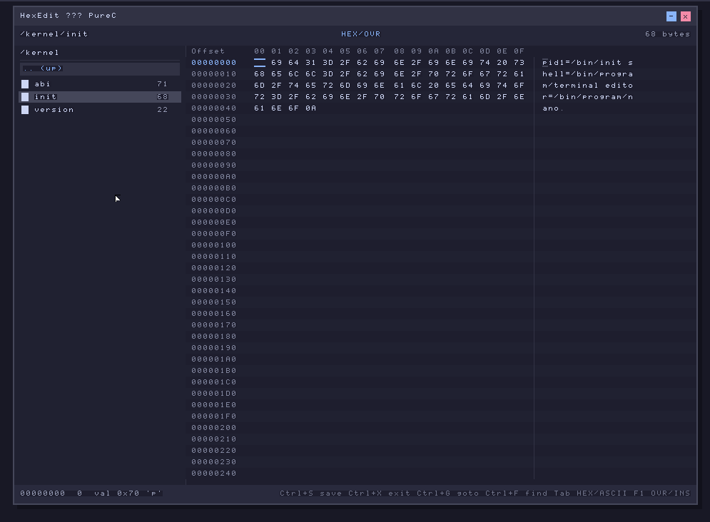
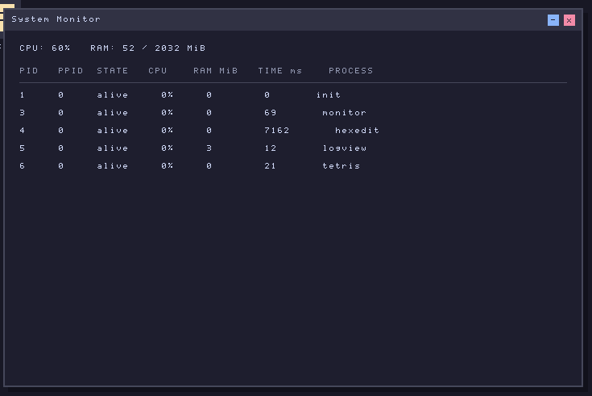

# PureC OS


PureC OS is a simple 64-bit operating system written in C and x86_64 assembly language and a bit of C++20. It includes

- Ring-3 user programs (ELF64, dynamic `.so` loading), the PureC shell `sh`, and init with units (`init`, `initctl`, `systemctl`)
- Network: TCP/UDP stack, DHCP client, DNS resolver, NTP client, ICMP ping, network drivers for Intel 82540EM, Intel 82543GC and AMD PCnet-PCI II (Wi-Fi drivers are in development, see [Network Support](#network-support))
- File systems: VFS with ext2, FAT32, tmpfs, devfs, procfs and sysfs; initramfs at boot
- Drivers: VGA text, GOP / VBE / VMware SVGA II framebuffers, PS/2 and USB keyboards and mice, AHCI and ATA PIO storage, Intel HDA audio, ACPI
- USB host controllers: xHCI and EHCI
- About 190 system calls, see [Syscall Reference](docs/syscalls-reference.md)
- Text virtual consoles tty1-tty6 (`vtcon`) with `getty` and login. The desktop, graphical login, terminal, settings, LibGUI and the display server (`videod`) are separate packages installed with `pkg` from the registry in `Trusted/`

---

## Software Port

[Porting Guide](ported-software.md)

---

## Network Support

Ethernet, supported in VirtualBox and QEMU:

- Intel Pro 1000 MT Desktop 82540EM (`src/drivers/net/e1000`)
- Intel Pro 1000 T Server 82543GC (`src/drivers/net/82543gc`)
- PCnet-PCI II (Am79C970A) (`src/drivers/net/pcnet`)

Wi-Fi (in development):

- Intel AX201 (`src/drivers/net/iwx`, a port of OpenBSD iwx, with the `iwxctl` utility)
- Atheros AR9285 (`src/drivers/net/ath9k`, a port of Linux ath9k)
- 802.11 association code lives in `src/net/802.11`

---

## Toolschain PureC OS

- gcc (GCC) 16.2.1 20260810
- g++ 16.2.1 20260810
- nasm 3.02 compiled on Jun 30 2026
- Limine 12.8.0
- VirtualBox Version 7.2.16 r174877
- Cross-Compiler x86_64-elf-gcc (GCC) 15.2.0
- GNU Make 4.4.1

---

## Details about Syscall PureC OS

[Link to Syscall Reference](docs/syscalls-reference.md)

## Details about Drivers PureC OS

[Index of driver documentation](docs/drivers/README.md)

---

## Sources and Related Repositories

Kernel: [PureC-OS](https://github.com/PureC-OS/PureC-OS) (this repository).

External sources are cloned by `./purec.py setup` (the `REPOS` list in `purec.py`). Submodules are listed in `.gitmodules`. Ports that have their own fetch script (`mk/git/fetch.sh`, `mk/netsurf/fetch.sh`, `mk/cxx/fetch.sh`, `mk/qt/fetch.sh`) are fetched by those scripts.

| Repository | Directory | Purpose |
| ----------------------------------------------------------------------------- | ------------ | -------------------------------------------------------------------------------------------------------------------------------------------------------------------- |
| [PureC-OS/PureC-OS-ACPI](https://github.com/PureC-OS/PureC-OS-ACPI) | `acpi/` | ACPI subsystem: RSDP/XSDT/FADT/DSDT tables, `_S5`, shutdown/reboot. Compiled into the kernel image; `bin/modules/acpi.elf` is also built. |
| [PureC-OS/libxcrypt](https://github.com/PureC-OS/libxcrypt) | `libxcrypt/` | libpurecrypt: SHA-512 / `$6$` password hashing (in-house, not upstream libxcrypt). Compiled into the kernel; `bin/modules/crypt.elf` is also built. |
| [PureC-OS/PureC-TCC](https://github.com/PureC-OS/PureC-TCC) | `tcc/` | C compiler (TCC port) for building Ring-3 programs within the OS. |
| [PureC-OS/PureC-OS-Userspace](https://github.com/PureC-OS/PureC-OS-Userspace) | `userspace/` | Desktop (shell, panels, applications on `video-backend`), shipped as the `userspace` package. |
| [PureC-OS/video-backend](https://github.com/PureC-OS/video-backend) | `video-backend/` | Display server `videod` and its client library, shipped as the `video-backend` package. |
| [PureC-OS/PureC-OS-LibGui](https://github.com/PureC-OS/PureC-OS-LibGui) | `PureC-OS-LibGui/` | PureGUI toolkit (`libgui`), shipped as the `libgui` package. |
| [pablaofficeal/PureC-OS-QT-Terminal](https://github.com/pablaofficeal/PureC-OS-QT-Terminal) | `programs/PureC-OS-QT-Terminal/` | Terminal emulator, shipped as the `terminal` package. |
| [pablaofficeal/PureC-OS-QT-Login](https://github.com/pablaofficeal/PureC-OS-QT-Login) | `programs/PureC-OS-QT-Login/` | Graphical login screen, shipped as the `login` package. |
| [pablaofficeal/PureC-OS-Settings](https://github.com/pablaofficeal/PureC-OS-Settings) | `programs/PureC-OS-Settings/` | System settings, shipped as the `settings` package. |
| [PureC-OS/purec-os-pkg](https://github.com/PureC-OS/purec-os-pkg) | `programs/purec-os-pkg/` | Package manager `pkg`. |
| [PureC-OS/PureC-OS-Trusted-PKG-URL](https://github.com/PureC-OS/PureC-OS-Trusted-PKG-URL) | `Trusted/` | Package registry: `registry.conf` (repositories) and `repository.conf` (packages). |

---

## Build Toolschain

<details>
<summary><b>Linux (Ubuntu)</b></summary>

On Ubuntu:

```bash
sudo apt update
sudo apt install make gcc g++ limine nasm
```

If not in the repositories (Old Ubuntu), then need to install `limine` manually.

```bash
sudo apt install xorriso mtools
git clone https://github.com/limine-bootloader/limine.git --branch=v8.x-binary --depth=1
cd limine && make
```

### Installing Cross-Compiler for x86_64

```bash
sudo apt install build-essential bison flex libgmp-dev libmpc-dev libmpfr-dev texinfo

# Download sources

wget https://ftp.gnu.org/gnu/binutils/binutils-2.42.tar.gz
wget https://ftp.gnu.org/gnu/gcc/gcc-14.1.0/gcc-14.1.0.tar.gz

tar -xf binutils-2.42.tar.gz
tar -xf gcc-14.1.0.tar.gz

# Build binutils

mkdir build-binutils && cd build-binutils
../binutils-2.42/configure --target=x86_64-elf --prefix=/usr/local --with-sysroot --disable-nls --disable-werror
make -j$(nproc) && sudo make install
cd ..

# Build GCC

mkdir build-gcc && cd build-gcc
../gcc-14.1.0/configure --target=x86_64-elf --prefix=/usr/local --disable-nls --enable-languages=c,c++ --without-headers
make all-gcc -j$(nproc) && sudo make install-gcc
make all-target-libgcc -j$(nproc) && sudo make install-target-libgcc
```

</details>

<details>
<summary><b>Linux (Fedora)</b></summary>

On Fedora:
```bash
sudo dnf update --refresh
sudo dnf install make gcc g++ limine nasm
```
If not in the repositories (Old Fedora), then need to install `limine` manually.

```bash
sudo dnf install xorriso mtools
git clone https://github.com/limine-bootloader/limine.git --depth=1
cd limine && make
```

### Installing Cross-Compiler for x86_64 Fedora

```bash
sudo dnf install gcc gcc-c++ make bison flex gmp-devel libmpc-devel mpfr-devel texinfo

# Download sources
wget https://ftp.gnu.org/gnu/binutils/binutils-2.42.tar.gz
wget https://ftp.gnu.org/gnu/gcc/gcc-14.1.0/gcc-14.1.0.tar.gz

tar -xf binutils-2.42.tar.gz
tar -xf gcc-14.1.0.tar.gz

# Build binutils
mkdir build-binutils && cd build-binutils
../binutils-2.42/configure --target=x86_64-elf --prefix=/usr/local --with-sysroot --disable-nls --disable-werror
make -j$(nproc) && sudo make install
cd ..

# Build GCC
mkdir build-gcc && cd build-gcc
../gcc-14.1.0/configure --target=x86_64-elf --prefix=/usr/local --disable-nls --enable-languages=c,c++ --without-headers
make all-gcc -j$(nproc) && sudo make install-gcc
make all-target-libgcc -j$(nproc) && sudo make install-target-libgcc
```

</details>

<details>
<summary><b>Linux (Arch)</b></summary>

```bash
sudo pacman -Syu

# Install basic dependencies
sudo pacman -S --needed base-devel git

# Install dependencies
sudo pacman -S make gcc g++ limine nasm
```

### Download source code `yay` from official AUR:

```bash
git clone https://aur.archlinux.org/yay.git
```

### Build and install `yay` from source code:

Navigate to the folder containing the cloned project and run the build and installation of the package:

```bash
cd yay
makepkg -si
```

### Check the installation of `yay`:

```bash
yay -V
```

## Building cross compiler for x86_64

```bash
yay -S x86_64-elf-gcc x86_64-elf-binutils
```

## Installing VirtualBox

### Package installation: Update the system and install the main package:

```bash
sudo pacman -S virtualbox
```

### Select host kernel modules

Depending on your kernel (usually `virtualbox-host-modules-arch` is used for the standard Linux kernel, or `virtualbox-host-dkms` if you are using a custom or ZEN kernel):

```bash
sudo pacman -S virtualbox-host-modules-arch
```

### Configuration after installation

Add your user to the vboxusers group to get access to USB devices:

```bash
sudo usermod -aG vboxusers $USER
```

### Load kernel modules

Load the kernel modules:

```bash
sudo modprobe vboxdrv
```

</details>

---

# Build PureC OS

clone repository

```bash
git clone https://github.com/PureC-OS/PureC-OS.git
cd PureC-OS
```

fetch the external repositories (first run only):

```bash
./purec.py setup
```

build the kernel, the programs and the ISO:

```bash
make            # same as make iso
make kernel     # kernel only
make programs   # Ring-3 programs only
make test       # host tests
```

or use the interactive menu, which also runs the image in QEMU:

```bash
./purec.py
./purec.py build [all|kernel|programs|iso|libs|userspace]
./purec.py run
```

The ISO is written to `bin/`. Packages for the desktop and the other graphical programs are not part of the ISO build; they are installed inside the system with `pkg` from the registry in `Trusted/`.

## Project layout

- `src/`: kernel (`src/kernel`), drivers (`src/drivers`), storage and file systems (`src/io`, `src/fs`), network stack (`src/net`), C library (`src/libc`), and Ring-3 programs (`src/programs`: `init`, `getty`, `sh`, `installer`, `netd`, `dhcpc`, `resolved`, `ntpd`, the `utils` set, and others)
- `mk/`: build fragments for ports (`git`, `curl`, `vim`, `qt`, `netsurf`, `cxx`, `tcc`, `sysroot`), asset generation (`gen_assets.py`) and the package tools (`pkg`)
- `rootfs/`: `/etc` seed files installed by the installer
- `assets/`: install manifest (`manifest.txt`), man pages and fonts
- `programs/`: `purec-os-pkg` (package manager) and the Terminal, Login and Settings packages
- `video-backend/`, `PureC-OS-LibGui/`, `userspace/`, `Trusted/`: packages and the package registry
- `docs/`: documentation, including [drivers](docs/drivers/README.md) and [syscalls](docs/syscalls-reference.md)
- `bin/`: build output (generated)

---

# TODO PureC OS Project

[todo.md](todo.md)

---

# Demo Foto

## Boot Screen



## UserSpace on the bare metal



## UserSpace



## System Settings



## Network



## Filesystem



## Hex Editor



## System Monitor


